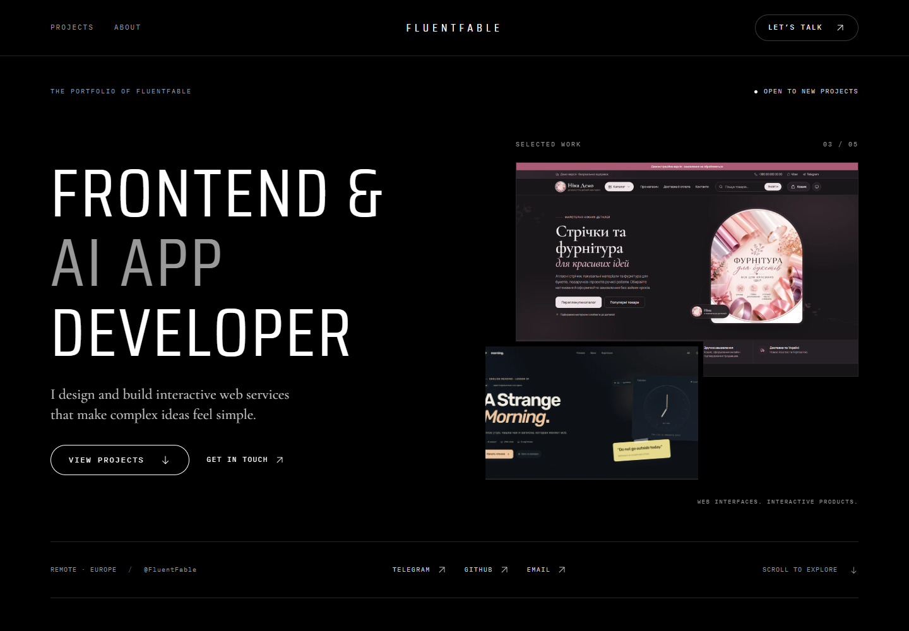

# FluentFable — Portfolio

Портфолио Frontend & AI App Developer. Главная, пять отдельных страниц проектов, живые демо, исходный код и контакты.

**Сайт:** https://portfolio-y5j.pages.dev/



## Дизайн

Основная дизайн-система — [`DESIGN.md`](./DESIGN.md): чёрный фон, белая разреженная типографика, прямоугольные изображения, тонкие линии и прозрачные контурные кнопки. Вместо автомобильной фотографии используются реальные интерфейсы проектов.

- Saira Condensed — заголовки; Cormorant Garamond — основной текст; IBM Plex Mono — навигация и подписи. Шрифты хранятся локально, лицензии SIL OFL — в `assets/fonts/`.
- Адаптивная навигация, фильтры сайтов и ботов, полноэкранные галереи с клавиатурой, миниатюрами и свайпами, копирование email.
- Плавное появление блоков и масштабирование изображений с поддержкой `prefers-reduced-motion`.
- Контент и ссылки доступны сразу в HTML. JavaScript дополняет интерфейс; загрузки JSON в браузере нет.
- Семантическая разметка, skip-link, видимый фокус, нативные модальные диалоги, метаданные каждой страницы, sitemap и отдельная 404.

## Контент

Исходные данные сохранены в двух файлах:

- [`data/profile.json`](./data/profile.json) — имя, никнейм, роль, полный текст био, статус, локация, аватар и все контакты.
- [`data/projects.json`](./data/projects.json) — все пять проектов, полные оригинальные описания, технологии, изображения, скриншоты и реальные ссылки.

Оригинальные PNG/JPG и SVG сохранены. WebP-копии используются для быстрых превью; галереи ботов открывают исходные скриншоты. Исходная документация до редизайна — [`docs/archive/README.original.md`](./docs/archive/README.original.md).

## Локальный запуск

Нужен Node.js 22 или новее. Зависимостей приложения и сборки нет.

```sh
npm ci
npm run build
npm run check
npm run dev
```

Откройте http://127.0.0.1:8080/. Другой порт: `npm run dev -- --port 8081`.

Проверка собранной версии:

```sh
npm run preview
```

Либо запустите `python -m http.server 8080` в корне: сгенерированные страницы уже находятся в репозитории.

## Структура

```text
data/                   Оригинальный контент, единый источник данных
src/render.mjs          Разметка главной, проектов и общих компонентов
assets/css/styles.css   Токены DESIGN.md, компоненты, адаптивность и анимации
assets/js/main.js       Навигация, фильтры, галереи, копирование email
assets/fonts/           Локальные WOFF2 и лицензии
assets/img/             Оригинальные изображения и WebP-превью
scripts/build.mjs       Генерация статического HTML и dist/
scripts/check.mjs       Проверка контента, страниц, локальных ссылок и синтаксиса
scripts/serve.mjs       Локальный HTTP-сервер
index.html              Сгенерированная главная
projects/*/index.html   Пять сгенерированных страниц проектов
404.html                Страница ошибки
dist/                   Результат сборки, не коммитится
_headers                Заголовки Cloudflare Pages
```

## Обновление

1. Отредактируйте JSON, изображения, стили или `src/render.mjs`.
2. Выполните `npm run build` и `npm run check`.
3. Закоммитьте исходники и обновлённые `index.html`, `projects/`, `sitemap.xml`.
4. Отправьте изменения в `main`.

Не редактируйте сгенерированные HTML вручную: следующая сборка восстановит их из исходных данных. При добавлении картинки проекта создайте одноимённую WebP-копию для превью; оригинал оставьте в `assets/img/projects/`.

## Публикация

Используется существующая интеграция **GitHub → Cloudflare Pages**, проект `portfolio`, production-ветка `main`. Обновления автоматически публикуются на https://portfolio-y5j.pages.dev/.

Корневая папка содержит готовые страницы и совместима с действующей настройкой публикации без build-команды. `npm run build` дополнительно создаёт `dist/` для локального preview или публикации артефакта. Менять настройки Cloudflare для обновления сайта не требуется.

GitHub Actions (`.github/workflows/verify.yml`) отдельно выполняет сборку, проверяет все локальные пути, сохранность контента, синтаксис JavaScript и совпадение опубликованных HTML с исходниками.

В `_headers` для HTML и JSON задана ревалидация, для статики — часовой кэш, для локальных шрифтов — длительный кэш. При смене домена обновите `siteUrl` в `src/render.mjs` и URL sitemap в `robots.txt`, затем выполните сборку.

## Проверки

`npm run check` проверяет главную, пять страниц проектов и 404; локальные ссылки и якоря; изображения и шрифты; корректность email и URL; отсутствие шаблонных профилей; наличие каждого исходного описания, тега, контакта и ссылки. Проверка не требует сети.

Для браузерной проверки: откройте главную и все страницы проектов на десктопе и телефоне; проверьте три фильтра, мобильное меню, галереи (кнопки, стрелки, Escape, миниатюры и свайпы), email и копирование, переходы к контактам и обратно к проектам. Анимации отключаются системной настройкой уменьшения движения.
