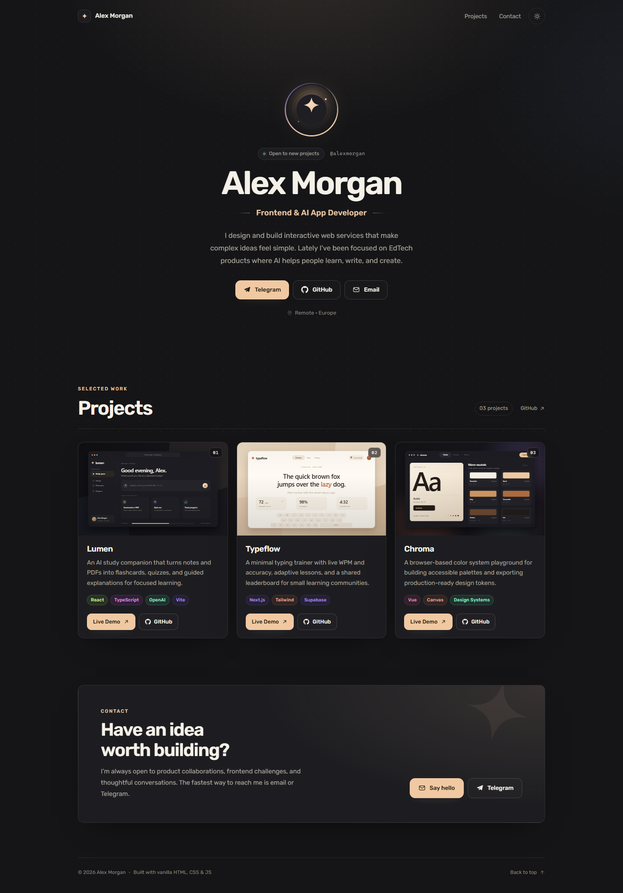

# Portfolio — GitHub Pages + Cloudflare Pages

Минималистичный сайт-портфолио на чистом HTML, CSS и JavaScript. Без сборки, без зависимостей и без фреймворков: загрузил на GitHub — сайт работает. Контент настраивается в двух JSON-файлах.



## Что внутри

- **Hero-блок:** круглая аватарка, имя, никнейм, роль «Frontend & AI App Developer», короткое био, статус и локация.
- **Кнопки связи:** Telegram, GitHub, Email. Порядок и наличие ссылок берутся из `data/profile.json`.
- **Проекты из JSON:** карточки со скриншотом, описанием, цветными тегами технологий и кнопками «Live Demo» / «GitHub».
- **Две темы:** тёмный угольный и тёплый молочно-кремовый. Переключатель запоминает выбор.
- **Аккуратный минимализм:** Rubik, скругления 14 px, мягкие hover-эффекты, анимации с учётом `prefers-reduced-motion`.
- **Адаптивность:** проверено на 390 px и 1440 px, без горизонтального скролла.
- **Готово к деплою:** workflow для GitHub Pages, `_headers` для Cloudflare Pages, локальные изображения-заглушки, favicon и OG-обложка.

## Быстрый старт

1. Измените `data/profile.json` — имя, ник, био, аватар и соцсети.
2. Измените `data/projects.json` — проекты и ссылки. Свои картинки положите в `assets/img/projects/`.
3. Проверьте локально (см. ниже) и запушьте в GitHub.

Никакой `npm install` и сборка не нужны.

## Структура

```text
.
├── index.html
├── assets/
│   ├── css/styles.css
│   ├── js/main.js
│   ├── favicon.svg
│   └── img/
│       ├── avatar.svg          # заглушка аватарки
│       ├── og-cover.png        # обложка для соцсетей
│       └── projects/           # скриншоты проектов
├── data/
│   ├── profile.json            # профиль
│   └── projects.json           # проекты
├── .github/workflows/deploy.yml
├── _headers                    # заголовки/кэш для Cloudflare Pages
├── .nojekyll                   # для GitHub Pages
├── preview.png
└── README.md
```

## Настройка профиля — `data/profile.json`

```json
{
  "name": "Alex Morgan",
  "nickname": "@alexmorgan",
  "role": "Frontend & AI App Developer",
  "bio": "Два предложения о вас.",
  "avatar": "./assets/img/avatar.svg",
  "status": "Open to new projects",
  "location": "Remote · Europe",
  "socials": {
    "telegram": "https://t.me/yourhandle",
    "github": "https://github.com/yourhandle",
    "email": "hello@example.com"
  }
}
```

| Поле | Обязательно | Что делает |
|---|---|---|
| `name` | да | Имя/псевдоним в hero, шапке и футере. |
| `nickname` | нет | Ник с `@` рядом со статусом. Можно писать без `@` — добавится сам. |
| `role` | нет | Подзаголовок под именем. По умолчанию «Frontend & AI App Developer». |
| `bio` | нет | Короткое описание (лучше 1–2 предложения). |
| `avatar` | нет | Ссылка или локальный путь к фото. Без него показывается `assets/img/avatar.svg`. |
| `status` | нет | Плашка статуса. Пустая строка или удаление поля скрывает её. |
| `location` | нет | Локация под кнопками. Удаление поля скрывает строку. |
| `socials.telegram` | нет | Полная ссылка, `t.me/handle` или `@handle`. |
| `socials.github` | нет | Полная ссылка, `github.com/user` или просто username. |
| `socials.email` | нет | Адрес почты или `mailto:...`. |

Если соцсеть не указана — кнопка просто не появится. Для аватарки подойдёт квадратное фото от 400×400 px; оно кадрируется в круг.

## Настройка проектов — `data/projects.json`

Файл — это массив. Каждый объект — одна карточка:

```json
[
  {
    "title": "Lumen",
    "description": "An AI study companion that turns notes and PDFs into flashcards, quizzes, and guided explanations.",
    "image": "./assets/img/projects/lumen.svg",
    "tags": ["React", "TypeScript", "OpenAI", "Vite"],
    "demo": "https://example.com",
    "repo": "https://github.com/yourhandle/lumen"
  }
]
```

| Поле | Обязательно | Что делает |
|---|---|---|
| `title` | да | Заголовок карточки. |
| `description` | нет | Описание, обрезается до 3 строк. |
| `image` | нет | Скриншот, GIF или WebP. Если картинки нет/она не загрузилась — рисуется заглушка с первой буквой названия. |
| `tags` | нет | Массив технологий. Показываются первые 6; цвет тега подбирается автоматически. |
| `demo` | нет | Ссылка на живой сайт. Если не указана, кнопки «Live Demo» не будет. |
| `repo` | нет | Ссылка на исходники. Если не указана, кнопки «GitHub» не будет. |

**Картинки:** рекомендуемый размер — 1600×1000 px (соотношение 16:10), PNG/WebP/GIF. Путь указывайте от корня сайта: `./assets/img/projects/my-project.webp`. Регистр букв важен на GitHub Pages.

Демо-проекты Lumen, Typeflow и Chroma — вымышленные. Замените их своими или оставьте один для примера.

## Локальный запуск

Открывать `index.html` двойным щелчком нельзя: браузер блокирует `fetch()` для `file://`. Нужен простой локальный сервер:

```powershell
cd portfolio
python -m http.server 8080
```

Откройте `http://localhost:8080`.

Альтернатива с Node.js:

```powershell
npx serve .
```

## Деплой на GitHub Pages

### Вариант A — GitHub Actions (рекомендуется)

1. Запушьте проект в репозиторий (ветка `main`).
2. Откройте **Settings → Pages → Build and deployment**.
3. В **Source** выберите **GitHub Actions**.
4. Workflow из `.github/workflows/deploy.yml` сам опубликует сайт при каждом пуше в `main`.

Сайт будет доступен по адресу `https://<username>.github.io/<repo>/`. Все пути относительные, поэтому подпапка репозитория работает без правок.

### Вариант B — без Actions

1. **Settings → Pages → Source: Deploy from a branch**.
2. Выберите ветку `main` и папку **`/ (root)`**.
3. Нажмите **Save**. Файл `.nojekyll` уже есть — Jekyll ничего не сломает.

В этом случае workflow можно удалить, чтобы он не пытался публиковать сайт параллельно.

## Деплой на Cloudflare Pages

1. Залейте репозиторий на GitHub.
2. В Cloudflare откройте **Workers & Pages → Create → Pages → Connect to Git**.
3. Выберите репозиторий.
4. Настройки сборки:
   - **Framework preset:** None
   - **Build command:** оставьте пустым
   - **Build output directory:** `/`
5. **Save and Deploy**.

Каждый пуш в `main` будет автоматически обновлять сайт. Файл `_headers` Cloudflare применяет сам: JSON отдаётся с `no-cache`, статика — с часовым кэшем, плюс базовые security-заголовки. GitHub Pages этот файл игнорирует.

Через CLI:

```powershell
npx wrangler pages deploy . --project-name=portfolio
```

После деплоя можно подключить свой домен в **Custom domains** — и там, и там.

## Обновление контента

Меняете только JSON и картинки → коммит → пуш. Пересборка не нужна. Браузер получает свежий `profile.json` и `projects.json` благодаря `cache: "no-cache"` в JS и `_headers` на Cloudflare. На GitHub Pages обновление обычно появляется в течение минуты.

## Кастомизация

- **Цвета:** переменные в начале `assets/css/styles.css` — блоки `:root` (тёмная тема) и `[data-theme="light"]` (кремовая).
- **Шрифт:** Rubik подключён в `<head>` `index.html`. Замените ссылку Google Fonts и переменную `--font`.
- **Тема по умолчанию:** `data-theme="dark"` в `<html>`. Если поменять на `light`, не забудьте поправить значение по умолчанию в JS (`applyTheme`).
- **Тексты блока Contact и подписи кнопок:** `index.html`; данные профиля подставляются из JSON.
- **OG-обложка:** `assets/img/og-cover.png`. После деплоя замените относительные пути в `og:image` и `twitter:image` на абсолютные (`https://ваш-домен/...`) — так соцсети показывают превью надёжнее. Там же стоит обновить `<title>`, `description` и OG-теги, если меняете имя.
- **Favicon:** `assets/favicon.svg`.

## Если что-то не работает

| Проблема | Решение |
|---|---|
| Проекты не загружаются, в консоли `Failed to fetch` | Страница открыта как `file://`. Запустите локальный сервер или откройте задеплоенный сайт. |
| `Projects didn’t load` после деплоя | Проверьте, что `data/projects.json` лежит в репозитории, путь совпадает и JSON валиден (нет лишних запятых). |
| Не видно картинки проекта | Проверьте путь и регистр букв. Лучше использовать `./assets/img/projects/file.webp` и загружать файл в репозиторий. |
| GitHub Pages отдаёт 404 | Проверьте **Settings → Pages**: выбран GitHub Actions и workflow завершился успешно, либо выбрана ветка `main` / root. |
| Кнопки соцсетей пропали | Поле пустое или ссылка не распознана. Используйте полный URL, `@handle` или корректный email. |
| Изменения не видны | Обновите страницу с `Ctrl+F5`; на Cloudflare при необходимости сделайте **Purge cache**. |
| Не переключается тема | Проверьте, не заблокирован ли `localStorage`; сайт всё равно работает, просто не запоминает выбор. |

## Технические детали

- Нет внешних JS-библиотек. Иконки — встроенный SVG.
- Аватары и скриншоты грузятся с `loading="lazy"`; внешние ссылки открываются с `rel="noopener noreferrer"`.
- Ссылки из JSON проверяются: разрешены только `http(s)` и `mailto`, поэтому `javascript:`-ссылки не попадут на страницу.
- Учитывается `prefers-reduced-motion`; есть skip-link, focus-visible и aria-подписи.
- Шрифт Rubik распространяется по SIL Open Font License.

---

Сделано как основа личного портфолио: меняйте JSON, тексты и цвета под себя.
